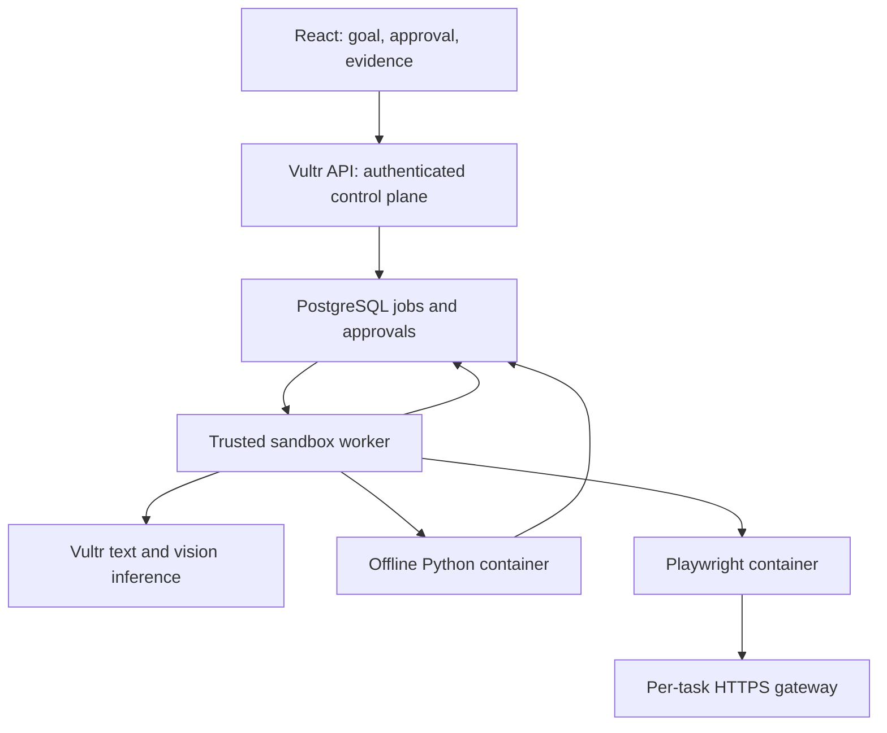

# TheCommander — Verified Workbench on Vultr

Verified research date: 2026-11-04. Implementation branch: **vultr only**. Read [the implementation plan](VULTR_PLAN.md) and [current verification](VULTR_VERIFICATION.md) before describing this release.

## Decision and hackathon fit

Enter **Blast Radius Zero**, demonstrating both Python execution and browser operation. Keep TheCommander as the existing product; submit the new Vultr work with explicit baseline disclosure. “OpenAI/Claude/Grok level” is a product direction, not an established capability or intelligence comparison. This implementation adds bounded execution and reviewable evidence; it does not train a frontier model.

### Event facts

| Item | Requirement / benefit |
|---|---|
| Online build | 3–8 November 2026 |
| Live-page deadline banner | November 8, 18:00 EST = 23:00 UTC; November 9, 04:30 IST |
| Team | 1–6; enroll on LabLab and join Discord |
| C1 infrastructure | Vultr VM backend, Vultr web deployment, Vultr Serverless Inference, isolated execution |
| Inference endpoint | `https://api.vultrinference.com/v1` |
| GPU | Unavailable for this event |
| Credits | $200 per participant; credit instructions require an email never associated with Vultr |
| Awards | First $5,000 cash + $3,000 credits; second $3,000 + $1,000; third $1,000 + $1,000 |
| Onsite | November 8, Pierpont Place, Salt Lake City; travel/lodging excluded; onsite raffle separate |
| Judging | Application of Technology, Presentation, Business Value, Originality; no event weights published |
| Entry | LabLab submission required; Vultr Community showcase optional |
| C1 evidence | GitHub/setup, public demo, recorded video, architecture/use case, visible containment moment |

Source: [event page](https://lablab.ai/ai-hackathons/vultr-hackathon). The live Firecrawl retrieval displayed the deadline banner; the static web extraction omitted it and listed the schedule as “to be announced.” Reconfirm the enrolled dashboard, including timezone, and submit early. Do not substitute the time of the onsite event for the submission deadline.

### Eligibility, reuse and rights

The [platform terms](https://lablab.ai/terms-of-use), revised July 1, 2025, require age 18+, authority to contract and compliance with sanctions restrictions. They require original open-source, MIT-compliant submissions unless overridden. Ownership remains with the author, but submitted content carries a broad platform usage license. Prize payouts are to individuals and require identity, tax and bank verification; organizers describe up to 90 days for distribution and a 90-day documentation deadline after notification. Confirm the actual payout instructions if selected.

**Existing-project eligibility remains unknown.** Neither the retrieved event brief nor rule book explicitly approves or prohibits extending an older repository. Building an additive Vultr branch is technically appropriate but does not establish eligibility. Disclose `96fcd1f8fdd0d64ebba486acb67e2c56e5851b7a` as the starting point and identify every new module, migration and UI. Obtain an organizer ruling before claiming the old project is eligible. Do not erase or rewrite old commits to imply a new build.

The [rule book](https://lablab.ai/hackathon-rules) says event/form instructions take precedence; videos and PDF slides are required by default, and the repository must be public. Plagiarism and manipulation can disqualify; organizers cannot compete for prizes. It describes a five-minute submission grace period; do not plan to use it. The [submission guide](https://lablab.ai/ai-hackathons/guidelines) describes a video within five minutes and under 300 MB. Check the current form's limits for title/descriptions and uploaded media. The event asks for a cover image; include a 16:9 image despite the general rule book calling it optional.

### Resources and credit steps

1. Enroll, create a team and join [LabLab Discord](https://discord.gg/lablabai). Enrollment and credits were not performed by this implementation session.
2. Follow the event's claim link, create/verify the eligible Vultr account, apply the supplied hackathon gift code in Billing and confirm $200 Remaining Credit. The public text does not supply a reusable gift code; use the enrolled flow or ask event support. Do not create accounts to evade eligibility rules.
3. Use [Serverless Inference provisioning](https://docs.vultr.com/products/compute/serverless-inference/provisioning) and the authenticated [model list](https://api.vultrinference.com/v1/models). Select a text model and a genuinely vision-capable model; listing alone does not prove multimodal support.
4. Review [Vultr's sandboxing guide](https://docs.vultr.com/how-to-set-up-agent-sandboxing-on-vultr-cloud-compute), [Vultr API](https://www.vultr.com/api/), [gVisor installation](https://gvisor.dev/docs/user_guide/install/), [Playwright Docker](https://playwright.dev/python/docs/docker), and [Docker security](https://docs.docker.com/engine/security/).
5. Keep deployments within the account credit budget, monitor usage and arrange payment/retirement after the event. Credit access does not mean unlimited usage or continuing free service. Optional Community exposure is not guaranteed.

## Repository review

Review scope: local source audit of TheCommander `vultr`, accessible repository inventory, and current README reads for these three public alternatives. This is not an exhaustive code audit of every repository.

| Repository | Observed fit | Recommendation |
|---|---|---|
| TheCommander | FastAPI/React/PostgreSQL, encrypted integrations, projects, memory, worker, exact GitHub approvals; isolated coding/browser modes unavailable at baseline | Best base: add sandbox control plane and preserve product continuity |
| [factory](https://github.com/RafalW3bCraft/factory) | Engineering/security agents, isolated workspaces and sandbox configuration; oriented around CLI coordination | Reuse architectural lessons, avoid importing a second orchestration stack during this event |
| [VeriForge](https://github.com/RafalW3bCraft/VeriForge) | Evidence-first investigation, typed findings, FastAPI/React; different sponsor integrations | Good verification concepts; larger cloud/provider migration for this brief |
| [DealPilotAI](https://github.com/RafalW3bCraft/DealPilotAI) | Commerce, catalog and PayPal approval; README explicitly reports incomplete live AI/payment evidence | More natural for its commerce hackathon; avoid mixing payment flows into this sandbox demo |

TheCommander baseline had no executable sandbox or Vultr adapter. Its earlier local/live Nebius evidence does not establish Vultr readiness. Existing `ask/plan/research/automate` permissions and unavailable legacy build/review modes remain intact. The new dedicated **Sandbox** workspace owns these explicit new capabilities.

## Implemented architecture



The API never gets a Docker socket. Browser networks explicitly use Docker’s `isolated` gateway mode; ordinary `--internal` networks still permit access to services on the host bridge address. See [Docker gateway documentation](https://docs.docker.com/engine/network/port-publishing/#gateway-modes). A separate trusted process claims project-scoped jobs; credentials remain in that control process. Existing encryption keys and all old integrations stay in place. New SQL migration 010 extends provider constraints and adds sandbox tables; it does not rebuild or drop existing data.

**Code flow:** Vultr generates validated JSON/Python → offline container → bounded stdout/stderr and actual Docker inspection receipt → one repair on a normal code error → Vultr explanation/verification. Time/output failures stop; a successful exit alone does not establish goal completion.

**Browser flow:** read-only driver observation → screenshot and page hash → Vultr vision check → bounded fill/click plan → human reviews exact selectors/values/target → password confirmation and single-use, ten-minute approval → fresh disposable browser checks the page hash before actions → screenshot and final vision check. No model-generated JavaScript or Python enters the browser driver. There is no authenticated browsing/session import in this release.

A crashed runner fails a code/read job and marks a previously approved browser job uncertain. It never blindly replays external effects. Cancellation kills at the next runner poll, but already completed actions cannot be undone. The reaper removes only labelled resources older than ten minutes; container-level timeouts also bound work if the client disappears.

### Threat model and containment

| Threat | Boundary / evidence | Remaining limit |
|---|---|---|
| Arbitrary code / host escape, CWE-94/CWE-269 | gVisor `runsc` by default; non-root; dropped caps; no new privileges; no host mounts; read-only root | Containers/gVisor still need patched hosts and runtime; not a mathematical zero-risk guarantee |
| Resource exhaustion, CWE-400 | 1 CPU; code 256 MiB, browser 768 MiB; 128 PIDs; 45 s default; 128 KB output; bounded temporary storage | Host-level quotas/monitoring and capacity planning still required |
| SSRF, CWE-918 | Internal per-job browser network with an isolated gateway; exact domain allowlist; CONNECT-only public HTTPS gateway; all DNS answers checked and pinned | DNS resolver/daemon remain trusted; approved sites can themselves perform server-side operations |
| Secret exposure | Clean Docker client config/environment; no provider keys or credentials in task containers | User-entered goal/value text can itself contain sensitive data; use public demo data |
| Approval replay / TOCTOU, CWE-367/CWE-862 | Session/CSRF, owner/project FK, recent reauthentication, plan/page/screenshot/domain/runtime digest, expiry, atomic consume, fresh page hash | Dynamic pages can conservatively fail; UI state cannot prove a remote transaction's business semantics |
| Prompt injection / forged “done” | Strict schema, fixed driver actions, no host execution fallback; process receipts separate from model verdict | Model verification remains fallible; text output can lie; hashes establish identity, not correctness |

Observation blocks non-GET/HEAD requests until approved actions begin. A website can implement side effects on GET; use an operator-controlled test domain. After approval, non-GET requests to allowlisted domains are possible and are part of the authority the user reviews. Do not use this initial release for payments, account administration or secrets. The browser base image is intended for testing/development; hardened non-root settings and gVisor do not remove the need for the live deployment gate.

## Deploy and run without replacing keys

Use a Vultr control VM and preferably a separate Vultr runner VM on a private network. A single VM is acceptable for an initial hackathon deployment with separate processes, gVisor and strict container boundaries; its trusted control plane has a larger common-host failure domain. This session provisioned neither option.

1. On **every checkout** verify `git branch --show-current` prints `vultr`. Fetch and fast-forward only that branch. Never merge into main, force-push or switch branches during this work.
2. Back up PostgreSQL and `.env.runtime` securely using existing operations instructions. Do not overwrite `.env`, `.env.runtime`, `ENCRYPTION_KEY`, bootstrap token or old provider keys.
3. Deploy the existing app with the existing start/HTTPS instructions. For a same-host native sandbox runner, enable only the optional loopback database port:

```sh
docker compose --env-file .env --env-file .env.runtime -f compose.yaml -f deploy/compose.sandbox.yaml up -d --build
```

For separate VMs use private-network PostgreSQL TLS, firewall the runner source and issue a dedicated least-privilege database login. Never publish PostgreSQL or Docker's daemon to the internet. Both processes must use the same application schema and encryption key to resolve the owner's encrypted Vultr connection.

4. Install **Docker Engine 28+** (required for isolated bridge gateways and safe loopback publishing) and gVisor following their current official instructions. Keep `SANDBOX_RUNTIME=runsc`; the code does not silently downgrade if it is absent. Browser namespace/seccomp compatibility must pass on this VM. Never “fix” it by adding privilege or disabling Chromium's sandbox.
5. Build the two trusted images on the runner from this branch:

```sh
docker build -f deploy/sandbox/Dockerfile.egress -t localhost/commander-egress:1 .
docker build -f deploy/sandbox/Dockerfile.browser -t localhost/commander-browser:1.64.1 .
uv sync --frozen
```

The browser package and base image both use Playwright 1.64.1. The checked-in upstream seccomp profile permits required user namespace operations. Resolve/pin the resulting image digests for a deployment release after smoke testing.

6. Add the new fields shown at the end of `env.release.example` to existing operator configuration. Keep `SANDBOX_ENABLED=false` until real containment passes, then enable it. Set explicit `SANDBOX_MODEL`, explicit `SANDBOX_VISION_MODEL`, and JSON `SANDBOX_BROWSER_DOMAINS=["your-approved-domain"]`. Do not use an unverified model ID from an old guide. Configure the **Vultr** connection in Settings, or import a server `VULTR_API_KEY` through the existing import flow. Existing Nebius/OpenAI/Anthropic keys remain untouched. The Sandbox worker always chooses Vultr, independent of the normal chat provider.
7. Start the worker natively with `DATABASE_URL` pointing to the same actual database. For a same-host Compose DB use port 5434 and its existing credential; the Compose hostname `db` is not resolvable from a native host process. `deploy/sandbox/commander-sandbox.service` expects `/opt/thecommander`, an unprivileged `commander-runner` account with Docker access, and a root-protected `/etc/thecommander/runner.env`. Set its database URL, schema, required application keys and sandbox fields there. Docker control access is powerful; never grant it to the public API user.

```sh
uv run python -m scripts.sandbox_preflight
uv run python -m scripts.sandbox_preflight --execute-probe
uv run python -m commander.sandbox.worker
```

These commands load the existing settings mechanism. Supply host-specific overrides through the service environment rather than editing old key names. Create `.runtime` for the service's bounded temporary state and grant only the required access. On normal native startup Docker uses `/var/run/docker.sock`; rootless/custom sockets are not implemented in this version.

8. Open Sandbox and confirm runner readiness. Test code, the controlled browser form, expiration/denial and a rejected private destination. Save exported receipts. Test owner logout/revocation and the original memory/research/GitHub flows again. Keep public demo access controlled and available to judges through an agreed demo credential; do not publish the bootstrap token or real owner password in README.

### Verification commands

```sh
uv run ruff check main.py commander memory_service tests scripts
uv run ruff format --check main.py commander memory_service tests scripts
uv run mypy commander
uv run pytest -q tests/test_sandbox_policy.py
# On a real PostgreSQL 17 test instance; do not point tests at production:
uv run pytest --cov=commander --cov-report=term-missing
npm --prefix frontend run build
npm --prefix frontend run lint
# Explicit real Docker/gVisor probe, on the runner only:
RUN_SANDBOX_DOCKER=1 RUN_SANDBOX_BROWSER=1 uv run pytest -q tests/test_sandbox_docker.py
```

Set `TEST_DATABASE_URL` before database tests. The existing `scripts/verify.sh` also runs browser workflows and dependency/secret checks. The added containment workflow exercises real Docker with **runc in CI**, explicitly distinct from the required gVisor deployment check. Missing Docker skips opt-in tests; a skip is not a pass. Fixture-based image checks are not live vision evidence.

## Demo, submission and scoring strategy

**Proposed title:** TheCommander — Verified Workbench on Vultr.

**Short description:** An engineering assistant that plans work with Vultr inference, runs Python and Playwright in disposable sandboxes, and returns execution receipts with human-approved browser actions.

**Long-description outline:** Developers need proof that an agent's work ran and stayed within authority. TheCommander extends its existing memory and scoped workflows with isolated Python execution, screenshot-verified browser operations and exact action approval. Explain the Vultr control VM, inference endpoint and runner, show receipts and a deliberate containment failure, disclose the old baseline, and distinguish deployed evidence from planned hardening. State which users benefit, a measured time-saving example, and intended per-seat/usage pricing as a proposal, not established revenue.

**Five-minute demo plan:** 0:00–0:35 problem/product; 0:35–1:35 real Python computation and actual receipt; 1:35–2:15 deliberate denied network/host write and destroyed container; 2:15–3:35 controlled form observation, vision check, exact approval and final screenshot; 3:35–4:15 Vultr architecture/live deployment; 4:15–5:00 practical value, differentiation, limitations and new-work disclosure. Use real output and show one task ID across UI/receipt. Do not run destructive host probes.

Map technology judging to live Vultr text+vision and container receipts; presentation to a coherent task and containment moment; business value to engineering analysis/site QA with measured task completion; originality to continuity plus evidence/authority, rather than another generic chat screen. No numerical benchmark or customer demand is established yet.

Submission checklist: enroll/team; eligibility ruling; public `vultr` branch link and exact commit; MIT/third-party notices; current README architecture/setup; Vultr public HTTPS demo; real inference/vision and containment receipts; five-minute MP4/MOV under the current form's size cap; PDF slides; 16:9 cover; titles/descriptions/tags; LabLab submit and saved confirmation. Community sharing is optional. Registration, final submission, media production and cloud deployment were not completed by writing this guide.

## Upgrade roadmap after the execution gates

| Priority | Backend | Frontend | Acceptance evidence |
|---|---|---|---|
| P0, current build | Vultr provider, bounded Python/browser jobs, approvals, receipts, restart safety | Sandbox task form, project history, plans, screenshots, approve/deny/cancel/export | Local contracts plus DB/CI and real deployment gates |
| P1 | Content-addressed artifact store, file upload scanning/quotas, diff-only workspace edits, richer language images | Split conversation/artifact panels, file previews, visible diffs and citations | Artifact path traversal/isolation tests; approved diff application receipts |
| P1 | Unified event streaming, per-step budgets and measured latency/cost; independently checked code test results | Live progress, token usage, model capability/status surfaces | Eval corpus with actual execution, regression/latency/cost distributions |
| P2 | Retrieval relevance/provenance evals, context compaction and owner-approved memory extraction | Source/context inspector, memory corrections, session search | Recall precision, stale-memory and cross-project leakage evaluations |
| P2 | Multi-user RBAC, separate queue/runner credentials, retention/delete jobs, signed receipt anchoring, per-task VM option | Team scopes, operator health, retention controls | Tenant isolation, restore drills, crash/replay and external security review |
| P3 | Additional approved browser actions and domain-specific workflows, parallel execution under quotas | Accessible multi-artifact workspaces, workflow templates | Controlled-site action coverage and business-task evaluation |

Do not let this roadmap delay real Vultr inference, vision, containment and demo evidence. None of these future rows is presented as implemented.
